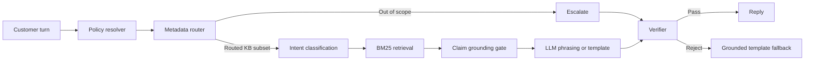

# Policy-Grounded Billing Dispute Agent

A policy-grounded billing support prototype for Cresta Agentic Assist. It answers from cited knowledge-base evidence, applies policy rules deterministically, and escalates unsupported or out-of-scope questions to Tier 2.

The workflow is built with **Python and LangGraph**. Optional LLM steps use **Groq or Anthropic**; the deterministic path works without API keys. **LangSmith** is used for evaluation and optional tracing.

## At A Glance

- **Policy first:** rule precedence, eligibility, and credit calculations are handled in code.
- **Evidence before wording:** each answer claim must be supported by a retrieved article.
- **Narrow context:** metadata routing limits which KB articles reach retrieval and response generation.
- **Fail closed:** unknown intents and unsupported claims escalate; failed LLM verification falls back to a grounded template.
- **Inspectable runs:** traces record routes, evidence, decisions, token counts, and verifier outcomes.

## How It Works



1. **Resolve policy and case facts.** The deterministic resolver checks precedence and computes applicable dates and credits before language-model calls.
2. **Route by KB metadata.** Article frontmatter supplies category, scope, governing rule, and tags. Category terms are scored with IDF weighting. Clearly out-of-scope turns escalate without an LLM call; only ambiguous routing may use the smaller router model. The current case rule's category is added for relevant follow-up questions.
3. **Classify and retrieve.** Intent uses a fixed set of allowed values, with a keyword fallback. BM25 ranks articles only within the routed subset.
4. **Ground claims, then phrase.** A deterministic gate checks whether each requested claim is supported and creates claim-tagged reply segments. The responder LLM, when enabled, receives those segments, evidence quotes, and computed facts rather than the whole KB.
5. **Verify the final reply.** The verifier checks numbers, dates, amounts, escalation language, segment-to-claim mapping, and sentence-level citations. If an LLM reply fails, the grounded template is returned.

Case memory carries known facts, checks, and per-turn decisions through a conversation. A circuit breaker disables LLM calls for the remainder of a run after the first API or structured-output failure.

## Token And Context Efficiency

The main optimization is **context selection**, not a custom tokenizer. Knowledge articles and policy rules are stored as separate Markdown files with YAML frontmatter. The metadata router narrows the corpus before BM25 retrieval, and only grounded claims plus their evidence are passed to the response model. Deterministic policy resolution and out-of-scope routing also avoid unnecessary LLM calls.

In a checked-in sample trace, the estimated KB context fell from **2,807 tokens for the full KB to 295 for the routed article bodies** (about 89% less KB text for that turn). This is a rough text-token estimate, not a tokenizer count, total prompt size, or guaranteed API-billing reduction. Provider-reported LLM input and output token counts are recorded separately in traces.

## Technology

| Technology | Use in this project |
|---|---|
| Python | Policy logic, routing, retrieval, verification, and CLI tools |
| LangGraph | Explicit multi-step workflow and shared turn state |
| BM25 | Ranking relevant articles inside the already-routed KB subset |
| Groq / Anthropic | Optional intent classification, ambiguous routing, and response phrasing |
| LangSmith | Optional tracing and evaluation runs |
| Markdown + YAML frontmatter | Small, independently routable KB articles and policy rules |
| `python-dotenv` | Local `.env` configuration |

## Quick Start

Python 3.10 or newer is required.

```bash
pip install -r requirements.txt
cp .env.example .env
python run.py
```

The default is `USE_LLM=0`, so no API keys are needed for deterministic runs. To enable a provider, set `USE_LLM=1`, choose `LLM_PROVIDER=groq` or `LLM_PROVIDER=anthropic`, and add the matching API key and model names to `.env`. `RESPONDER_MODEL` is used for intent and response phrasing; `ROUTER_MODEL` is used only when keyword routing is ambiguous.

### Useful Commands

| Command | Purpose |
|---|---|
| `python run.py` | Run the sample transcript and write a JSON trace under `traces/` |
| `python ask.py` | Ask questions interactively against the case memory |
| `python ask.py --fresh` | Start without replaying the transcript into case memory |
| `python ask.py --no-llm` | Force deterministic behavior in the interactive session |
| `python -m unittest discover tests` | Run the test suite; LLM calls are faked |
| `python scripts/run_paraphrases.py` | Run paraphrase cases and save a trace |
| `python scripts/eval_langsmith.py` | Run the LangSmith evaluation when `LANGSMITH_API_KEY` is configured |

Type `quit` to leave the interactive `ask.py` session. Use `--recreate` with the LangSmith evaluation script after changing `data/eval_cases.json`.

## Evaluation Snapshot

The checked-in evaluation set contains 26 cases with expected decisions, governing rules, and cited articles: transcript turns, unseen questions, rule-boundary scenarios, and paraphrases.

- Deterministic mode passes the transcript turns, unseen questions, and all eight policy scenarios. It gets 7 of 9 paraphrases; the two known misses escalate instead of guessing.
- In the recorded Groq paraphrase run, all 9 cases reached the expected decision, rule, and articles. The verifier rejected three replies with misplaced citations and used the template instead.
- The LangSmith run recorded 24 scored cases; two were unscored because of an evaluator error. See `traces/` and `tests/` for run artifacts and coverage.

These are prototype results, not a production accuracy or latency guarantee. The verifier checks structural and value-level constraints; semantic faithfulness still needs broader human-labeled evaluation.

## Decisions

| Outcome | Meaning |
|---|---|
| `ANSWER` | Every required claim is grounded in retrieved evidence. |
| `PARTIAL` | Supported claims are answered; unsupported parts are escalated. |
| `ESCALATE` | The request is unsupported, out of scope, unknown, or blocked by policy. |
| `NO_QUESTION` | The turn adds case details but asks no question. |

## Project Layout

```text
graph.py                 LangGraph workflow and transitions
resolver.py, facts.py    Deterministic policy resolution and case facts
router.py, retriever.py  Metadata routing and BM25 retrieval
gate.py, verifier.py     Claim grounding, templates, and reply checks
llm.py, config.py        Provider adapters, validation, and configuration
memory.py                Conversation state
data/kb/                 Knowledge articles
data/policy/             Policy rules
data/raw/                Source documents
tests/                   Unit and scenario tests
scripts/                 Paraphrase and LangSmith evaluation tools
traces/                  Saved run traces
```

## Scope And Limitations

This prototype tracks one governing rule per case. A customer discussing multiple disputes governed by different rules needs per-dispute memory before the system can reliably keep those decisions separate. The evaluation set is small, and the deterministic keyword path intentionally escalates some paraphrases it does not recognize.
